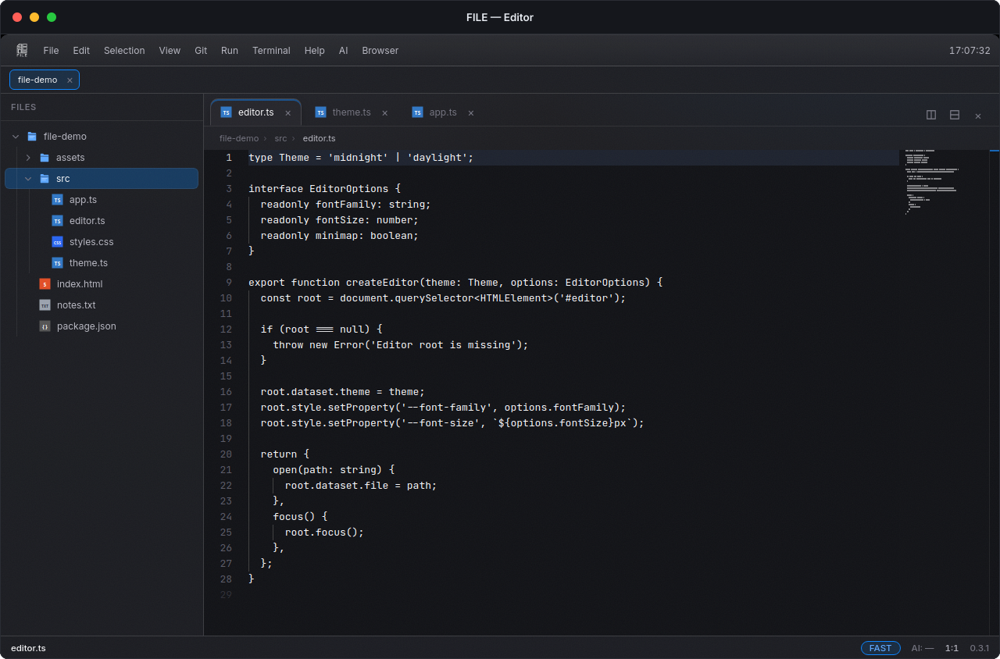

<h1 align="center">FILE</h1>

<p align="center">A keyboard-first desktop code editor with Monaco, a real terminal, Git, a built-in browser and local or cloud AI.</p>

## Screenshots

<p align="center">
  
</p>

## Features

- Monaco editor with multi-cursor editing, split panes and tabbed files
- Real PTY terminal with xterm, opened in the current workspace
- Git panel for staging, commits, push and pull without leaving the keyboard
- Built-in browser tabs that keep their own history
- Local Qwen model plus OpenAI-compatible cloud providers with safe file writes
- Keyboard-first menus, command palette and file explorer
- Image, audio and video previews inside the editor
- Linux and Windows builds from source or prebuilt packages

## Installation

Build and run from source:

```bash
git clone https://github.com/colgecen/FILE.git
cd FILE
./file --install
```

`--install` is a one-time step that lets you type `file` (no `./`) to open the build menu:

```bash
file
```

Prebuilt binaries are available on the [Releases](https://github.com/colgecen/FILE/releases) page.

## Usage

Run the app straight from source (press `Ctrl+C` to stop):

```bash
./file
```

Open a folder with `Ctrl+K Ctrl+O` or from the File menu, then pick a file in the explorer. Press `F1` for the menu, `Ctrl+I` for the command palette, `Ctrl+"` for the terminal and `Ctrl+G` for the Git panel; `Esc` closes menus and dialogs. Session state, recent files and settings are stored in the app's Electron user-data directory.

## License

This project is licensed under the [MIT](LICENSE) license.
