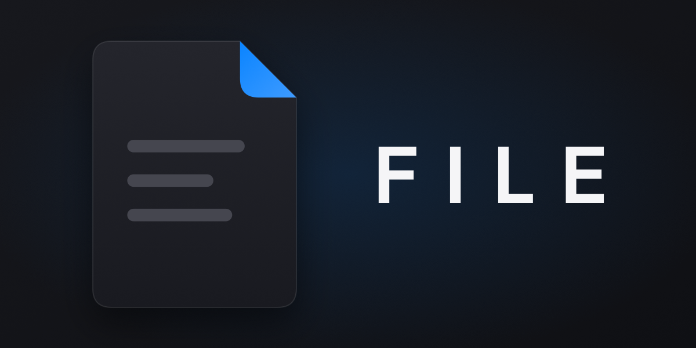

<p align="center">
  
</p>

<h1 align="center">FILE</h1>

<p align="center">
  Klavye-öncelikli, masaüstünde çalışan kod editörü.<br>
  Electron + React + Monaco + gerçek terminal + yerel ve bulut yapay zekâ.
</p>

<p align="center">
  <a href="https://github.com/colgecen/FILE/actions/workflows/ci.yml">
    
  </a>
  
  <a href="LICENSE"></a>
</p>

---

## Özellikler

- **Monaco editör** — VS Code'un motoru; çoklu imleç, satır içi diff önizleme
- **Gerçek terminal** — `node-pty` + xterm; `Ctrl+"` ile anında açılır
- **Git paneli** — sahneleme, commit, push, pull; tamamı klavyeyle
- **Yerleşik tarayıcı** — uygulama içi tek motor, birden fazla sekme; dışarıdan Zen/Chrome/Firefox gerekmez
- **Yapay zekâ** — cihaz içi model (Qwen) + OpenAI uyumlu bulut sağlayıcıları; güvenli dosya yazma
- **Bölünmüş paneller ve sekmeler** — fareye ihtiyaç duymadan düzen yönetimi
- **Görsel dil** — premium karanlık zemin, macOS tarzı cam (glassmorphism) paneller, Inter + JetBrains Mono tipografisi, tek vurgu rengi mavi; kırmızı yalnızca hata; yumuşak köşeler

## Gereksinimler

- Node.js v24 (`export PATH="$HOME/node/bin:$PATH"`)
- npm
- İlk kurulumda Electron binary'si indirilir (internet gereklidir)

## Kurulum ve Çalıştırma

```bash
npm install
npm run dev
```

## Komutlar

| Komut | Açıklama |
|-------|----------|
| `npm run dev` | Geliştirme (electron-vite, HMR) |
| `npm run build` | Üretim paketi |
| `npm run start` | Üretim önizlemesi |
| `npm run dist` | electron-builder ile kurulabilir çıktı |
| `npm run dist:linux` / `dist:win` / `dist:mac` | Platforma özel paket |
| `npm run typecheck` | TypeScript kontrolü (main + renderer) |
| `npm run lint` | ESLint |
| `npm run format` | Prettier |
| `npm test` | Vitest |
| `npm run test:watch` | Vitest (izlemeli) |

## Klavye Akışları

| Tuş | İşlev |
|-----|-------|
| `F1` | Menü çubuğunu aç/kapat |
| `Tab` / `↑` `↓` | Açık alt menü ve dosyalar arasında gezinme |
| `F3` / `Shift+F3` | Gezginde sonraki / önceki klasör |
| `Ctrl+I` veya `Ctrl+P` | Komut paleti (`tree` yazarak sol gezgini aç) |
| `Ctrl+O` | Dosya aç |
| `Ctrl+K` `Ctrl+O` | Klasör aç |
| `Ctrl+"` | Terminal aç |
| `Ctrl+G` | Git paneli aç/kapat |
| `Ctrl+W` | Aktif sekmeyi kapat |
| `Ctrl+Tab` / `Ctrl+Shift+Tab` | Sonraki / önceki sekme |
| `Ctrl+Alt+↑` `↓` | Yukarı/aşağı imleç ekle |
| `Ctrl+Shift+L` | Tüm eşleşmelere imleç ekle |
| `Enter` / `Esc` | Seçim ve kapatma |

Tuş eşlemeleri merkezi `Keymap` kaydında (`src/core/defaultBindings.ts`) tutulur; doğrudan hardcode edilmez.

## Tarayıcı

Uygulama içi tek bir tarayıcı motoru (Electron'un kendi motoru) ile çalışır; hiçbir harici
tarayıcı (Zen, Chrome, Chromium, Firefox) başlatılmaz veya gömülmez.

- `Tarayıcı → Yeni Tarayıcı Sekmesi` yeni sekme açar; tarayıcı araç çubuğundaki `+` düğmesi
  her zaman yeni sekme açar (etiketindeki adresten ya da boş sekmeden).
- Her sekme kendi geçmişiyle bağımsızdır; geri/ileri/yenile o sekmede çalışır.
- Sekmeler üst şeritte ortam çipleri olarak görünür — çip seçmek, çarpı sekme kapatmak demektir.
- Adres çubuğuna `site.com` yazıp `Enter` sekmede açar, kelime girersen arama yapar.

## Paketleme

`npm run dist:all` ile üç platform için üretilir:

| Platform | Çıktılar |
|----------|----------|
| Linux | AppImage, deb, rpm, tar.gz |
| Windows | NSIS kurulum, portable, zip |
| macOS | dmg, zip (x64 + arm64) |

## Yapay Zekâ

- **Sağlayıcılar:** Yerleşik (cihaz içi Qwen) + OpenAI uyumlu: OpenAI, DeepSeek, Groq,
  OpenRouter, Ollama (`:11434`), LM Studio (`:1234`), llama.cpp (`:8080`), özel endpoint.
- **Anahtarlar:** OS anahtarlığında şifreli (`safeStorage`); yoksa `OPENAI_API_KEY`,
  `DEEPSEEK_API_KEY`, `GROQ_API_KEY`, `OPENROUTER_API_KEY` env değişkenleri okunur.
  Anahtar değeri log/IPC'ye düşmez, yalnızca var/yok taşınır.
- **Yerel tarama:** açılışta değil, `Yapay Zekâ → Modelleri Yenile` (veya paneldeki ⟳)
  ile Ollama/LM Studio/llama.cpp taranır; biri çökse diğerleri yine listelenir.
- **Sohbetler:** panel üstünde sekmeler; akış sürerken sekme geçişi engellenir.
- **Kipler:** Plan (diff önizleme + `ai.apply.confirm` onayı) / Yapım (doğrudan yazar).
  Efor: Düşük/Orta/Ultra (token + sıcaklık presetleri).
- **Güvenli yazma:** `ai.apply` son önerideki ` ```yol ` bloklarını yalnızca aktif proje
  kökü altına yazar (`..` kaçışı ve `/proj-evil` önek tuzağı reddedilir), açık sekmeyi tazeler.

## Yapılandırma

- `TRANSPARENT=1` ortam değişkeni ile saydam pencere + cam (blur) efekti denenebilir; desteklenmeyen ortamlarda mat siyah zemin kullanılır:
  `TRANSPARENT=1 npm run dev`

## Proje Yapısı

```
src/        Renderer (React + TypeScript)
  core/     Keymap, komut kaydı, odak yönetimi, modeller
  editor/   Monaco entegrasyonu ve tema
  menus/    Menü ağacı ve menü çubuğu
  terminal/ xterm görünümleri
  ai/       Sağlayıcılar, tarama, sohbet, güvenli yazma
  ui/       Paneller, sekmeler, gezgin, durum çubuğu
electron/   Main Process
  main/     fs, pty, git, uygulama içi tarayıcı (WebContentsView), AI anahtarları, telemetri
  preload/  Güvenli köprü (contextBridge)
assets/     Banner ve logo (SVG + PNG)
```

## Lisans

[MIT](LICENSE) © 2026 colgecen
